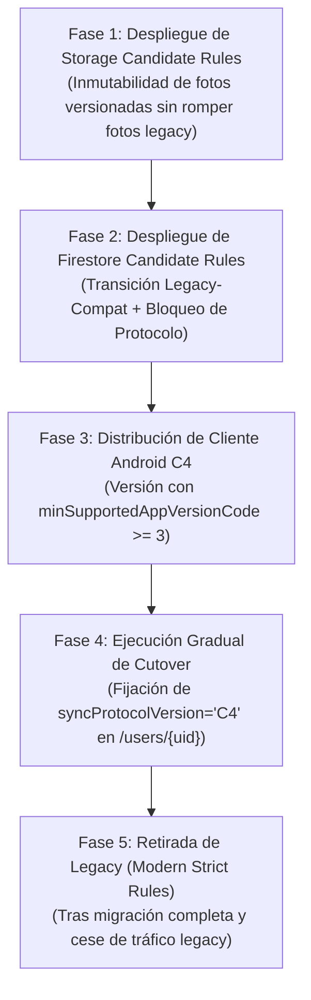

# Informe de Preparación y Seguridad Firebase (Fase C4 Release Readiness)

**Fecha:** 19 de noviembre de 2026  
**Rama:** `feat/c4-firebase-rules-readiness`  
**Commit base:** `71c737e` (`feat(c4): sincronizacion de fotografias con storage emulator y persistencia local`)  
**Estado:** Validación Perimetral Automatizada Completada (106 pruebas unitarias de reglas superadas, 100% éxito)

---

## 1. Resumen Ejecutivo y Arquitectura Perimetral

Como paso previo e indispensable para una futura migración del Protocolo C4 a cuentas reales y entornos de producción, se ha diseñado, formalizado y validado herméticamente el perímetro completo de **Reglas de Seguridad para Cloud Firestore y Firebase Storage**.

### Principios de Aislamiento y No Invasividad

1. **Cero despliegue en producción:** No se ha ejecutado `firebase deploy` ni se ha activado C4 para usuarios reales.
2. **Preservación estricta de archivos de producción:** Los archivos `firestore.rules`, `storage.rules` y `firebase.json` permanecen completamente **intactos**.
3. **Reglas candidatas independientes:** Las especificaciones candidatas para producción se ubican en archivos dedicados:
   - `firestore.candidate.rules` (raíz y fixture de pruebas).
   - `storage.candidate.rules` (raíz y fixture de pruebas).
4. **Infraestructura de emulación hermética:** Las pruebas se ejecutan contra un entorno configurado en `tests/firebase-rules/firebase.rules-test.json` con puertos aislados (Firestore: 18888, Storage: 19199, Auth: 19099, Hub: 14400, Logging: 14500) y proyecto demo `demo-rules-readiness`, evitando cualquier colisión o alteración de los emuladores de desarrollo activo (puertos 8888, 9099, 9199).

---

## 2. Especificación Técnica de las Reglas Candidatas

### 2.1 Perímetro Cloud Firestore (`firestore.candidate.rules`)

El archivo candidato consolida la totalidad del modelo de seguridad de Birrómetro, combinando la compatibilidad de transición Legacy <-> C4, el bloqueo de migración a nivel de cuenta y las colecciones sociales existentes:

#### A. Protección y Bloqueo de Protocolo (`/users/{userId}`)
- **Invariante C4:** Si un documento de usuario posee `syncProtocolVersion == 'C4'`, las reglas impiden terminantemente:
  - Revertir el protocolo a `'LEGACY'` o eliminar dicho campo.
  - Reducir el valor de `minSupportedAppVersionCode` (debe ser `>=` a la versión ya registrada, típicamente `3`).
  - Modificar o alterar el timestamp de corte `c4MigratedAt`.
  - Borrar físicamente el documento del usuario (`allow delete: if isOwner(userId) && resource.data.get('syncProtocolVersion', null) != 'C4'`).
- **Coexistencia y perfil básico:** Se autoriza a los clientes actualizar campos estándar de perfil (`email`, `emailLowercase`, `alias`) mediante operaciones `set(..., SetOptions.merge())` (como realiza `AuthRepository`), validando la integridad del bloqueo sin fricciones.

#### B. Ciclo de Vida y Transición de Cervezas (`/beers/{beerId}`)
- **Clientes Legacy (sin revisión):** Permite creación, actualización y borrado físico de documentos que carezcan del campo `revision`, asegurando compatibilidad hacia atrás total.
- **Creación C4 (`isModernCreate`):** Exige inicialización estricta en `revision == 1`, `isDeleted == false`, un `lastMutationId` válido y un mapa `fieldRevisions` canónico con las 5 unidades (`TYPE`, `TIMESTAMP`, `LOCATION`, `COMMENT`, `PHOTO`) exactamente en 1.
- **Actualización Monótona C4 (`isModernUpdate`):** Exige avance monotónico estricto (`request.resource.data.revision == resource.data.revision + 1`), cambio de `lastMutationId` (idempotencia y detección de colisiones), inmutabilidad del propietario (`userId`) y coherencia causal estricta en `fieldRevisions` (cada unidad lógica solo avanza si su campo asociado ha variado).
- **Anti-Resurrección de Tombstones:** Una vez que un documento alcanza `isDeleted == true`, se prohíbe de forma inviolable su transición de vuelta a `false`.
- **Inmunidad frente a borrado físico:** Queda prohibido `deleteDoc` sobre cualquier documento moderno (que contenga `revision`). Las bajas deben propagarse como mutaciones lógicas (tombstones).
- **Upgrade Atómico Legacy -> C4 (`isLegacyUpgrade`):** Permite a un documento legacy sin revisión promoverse directamente a C4 en `revision 1` con su vector inicial de revisiones.
- **Anti-Regresión:** Un documento C4 (con `revision`) no puede ser sobrescrito con un payload legacy desprovisto de revisión.

#### C. Preservación de Funcionalidades Existentes
Se conservan con fidelidad absoluta los contratos de seguridad para:
- `/publicUsers/{userId}`: Creación y edición por el propietario restringida a claves autorizadas (`uid`, `displayName`, `photoUrl`, `createdAt`, `updatedAt`), lectura autenticada global y prohibición de borrado.
- `/usernames/{username}`: Acceso directo bloqueado (gestionado exclusivamente por Cloud Functions).
- `/friendships/{friendshipId}`: Solicitud inicial `PENDING`, aceptación cruzada `ACCEPTED`, lectura y borrado por participantes.
- `/groups/{groupId}` y `/comments/{commentId}`: Permisos de administración, adhesión/abandono de miembros, ciclo de vida de comentarios y validación de autores contra `publicUsers`.
- `/sharedBeers/{beerId}`: Lectura para propietario y amigos aceptados; escritura denegada a clientes directos.

---

### 2.2 Perímetro Firebase Storage (`storage.candidate.rules`)

El archivo candidato implementa las garantías necesarias para la persistencia inmutable de fotografías:

- **Ruta de fotografías:** `/users/{userId}/beers/{fileName}`.
- **Detección inequívoca de versión:** Función `isVersionedPhoto()` mediante expresión regular:
  `^([0-9a-fA-F]{8}-[0-9a-fA-F]{4}-[0-9a-fA-F]{4}-[0-9a-fA-F]{4}-[0-9a-fA-F]{12}|sync-[a-zA-Z0-9-]+)_([0-9a-fA-F]{8}-[0-9a-fA-F]{4}-[0-9a-fA-F]{4}-[0-9a-fA-F]{4}-[0-9a-fA-F]{12}|mut-[a-zA-Z0-9-]+)\.(jpg|jpeg|png|webp)$`
- **Inmutabilidad Absoluta:**
  - Creación permitida únicamente si el archivo **no existe previamente** (`resource == null`).
  - Prohibición estricta de actualización (`allow update: if isOwner() && !isVersionedPhoto() ...`).
  - Prohibición estricta de borrado (`allow delete: if isOwner() && !isVersionedPhoto()`).
- **Compatibilidad Legacy:** Archivos con nomenclatura no versionada (ej. `mi_cerveza.jpg` o `foto_1.jpg`) pueden ser creados, actualizados y eliminados libremente por su propietario.
- **Control de Acceso y Amigos:** Lectura concedida al propietario y a amigos confirmados mediante consulta cruzada a Firestore (`friendships/$(friendshipId).status == 'ACCEPTED'`).
- **Validaciones Perimetrales:** Límite de tamaño `< 5MB` y restricción MIME `image/.*`.

---

## 3. Resultados de la Suite Automatizada de Validación

La suite completa de validación de reglas de seguridad Firebase fue ejecutada contra los emuladores oficiales en puertos aislados. Se evaluaron **106 casos de prueba**, todos finalizados con resultado **passing (100% de éxito)**.

### Desglose por Escenarios Candidatos (`candidate-readiness.test.js` - 32 pruebas)

| Escenario | Aspectos Validados | Resultado |
| :--- | :--- | :---: |
| **1. Aislamiento entre usuarios** | Denegación de lectura, edición y borrado cruzado en Firestore; denegación de upload en storage ajeno; denegación de acceso a `/users/{uid}` ajeno. | **3/3 PASS** |
| **2. Rechazo no autenticado** | Bloqueo absoluto de operaciones sin credenciales en cervezas, storage, usuarios y perfiles públicos. | **2/2 PASS** |
| **3. Creación y avance monótono C4** | Creación válida en rev 1; avance monotónico rev 1 -> 2 con mutación coherente; avance rev 2 -> 3 propagando múltiples `fieldRevisions`. | **3/3 PASS** |
| **4. Rechazo de anomalías y colisiones** | Rechazo de creación en rev != 1; rechazo de mutaciones obsoletas (rev 2->1), estancadas (rev 2->2) o con huecos (rev 2->4); rechazo de reutilización de `lastMutationId`; rechazo de avance ficticio o inconsistente de `fieldRevisions`. | **4/4 PASS** |
| **5. Anti-resurrección y borrado físico** | Prohibición de `deleteDoc` en documentos con revisión; aplicación válida de tombstone (`isDeleted: true`); rechazo estricto de resurrección (`isDeleted: true -> false`); rechazo de borrado de tombstones. | **3/3 PASS** |
| **6. Inmutabilidad de fotos en Storage** | Subida exitosa inicial; rechazo tajante de sobrescritura de foto versionada existente; rechazo de borrado; validación de formato UUID dual inmutable. | **3/3 PASS** |
| **7. Control de fotos entre usuarios** | Bloqueo de lectura a extraños y amistades `PENDING`; autorización inmediata de lectura ante amistad `ACCEPTED` verificada en Firestore. | **1/1 PASS** |
| **8. Coexistencia y migración Legacy** | Creación, edición y borrado físico de documentos legacy; upgrade atómico legacy -> C4 rev 1; bloqueo de regresión legacy sobre documentos C4; upload, overwrite y delete de fotos legacy no versionadas. | **4/4 PASS** |
| **9. Bloqueo de Protocolo en `/users/{uid}`** | Escritura de lock C4 (`syncProtocolVersion: C4`); rechazo de reversión a `'LEGACY'`; rechazo de degradación de `minSupportedAppVersionCode`; rechazo de alteración de `c4MigratedAt`; rechazo de borrado de cuenta C4; autorización de actualización de alias/email con merge. | **5/5 PASS** |
| **10. No regresión funcional global** | Cumplimiento estricto de esquemas en `publicUsers`, invitaciones y relaciones en `friendships`, administración y comentarios en `groups`, y lectura protegida en `sharedBeers`. | **4/4 PASS** |

### Desglose de Pruebas de Regresión y Concurrencia (74 pruebas adicionales)
- `baseline.test.js`: 12 pruebas superadas (auditoría del comportamiento base y confirmación de vulnerabilidades mitigadas).
- `concurrency-retries.test.js`: 11 pruebas superadas (simulación de carreras, Compare-And-Swap perimetral, reintentos de cliente).
- `firestore-legacy-compat.test.js`: 15 pruebas superadas (verificación causal exhaustiva de `fieldRevisions`).
- `firestore-modern.test.js`: 26 pruebas superadas (reglas estrictas modernas).
- `storage-security.test.js`: 10 pruebas superadas (límites de tamaño, tipos MIME, invariantes de perfiles).

**Total acumulado:** **106 tests ejecutados, 106 superados (0 fallos).**

---

## 4. Procedimiento Operativo de Despliegue en Producción

Para el momento en que se decida migrar la base de usuarios reales a C4, se establece el siguiente **orden estricto de activación por fases**:



### Detalle de las Fases

1. **Fase 1 — Despliegue de Reglas de Storage:**
   - Desplegar `storage.candidate.rules` sustituyendo `storage.rules`.
   - **Efecto:** Protege inmediatamente contra colisiones de subida a cualquier cliente moderno sin afectar las fotos existentes ni el flujo legacy de usuarios en producción.
2. **Fase 2 — Despliegue de Reglas de Firestore (Transición y Bloqueo):**
   - Desplegar `firestore.candidate.rules` sustituyendo `firestore.rules`.
   - **Efecto:** Los clientes antiguos siguen operando sin notar cambios en documentos legacy. Los clientes que inicien corte a C4 quedan protegidos contra regresiones y escrituras inconsistentes.
3. **Fase 3 — Despliegue de la Aplicación Android C4:**
   - Publicar en Google Play la versión de la app compatible con Protocolo C4 (`versionCode >= 3`).
4. **Fase 4 — Migración de Cuentas (Cutover Controlado):**
   - A medida que los usuarios abren la aplicación actualizada, `C4StagingCutoverManager` ejecuta la reconciliación local, realiza el PUSH a Firestore y sella el bloqueo de protocolo mediante `writeAccountProtocolLock(uid)`.
   - Una vez sellado, el usuario no puede ser degradado ni por fallos de sincronización ni por clientes antiguos.
5. **Fase 5 — Cierre de Transición y Perfil Estricto (Futuro):**
   - Cuando el 100% de los usuarios activos hayan migrado y las versiones antiguas de la aplicación queden deshabilitadas, se promoverá `firestore.modern-strict.rules` a producción, eliminando definitivamente las ramas `isLegacyCreate`, `isLegacyUpdate` y `isLegacyUpgrade`.

---

## 5. Matriz de Riesgos y Mitigaciones

| Riesgo Identificado | Impacto | Nivel de Severidad | Mitigación Implementada |
| :--- | :--- | :---: | :--- |
| **Cliente legacy sobrescribe una cerveza C4** | Pérdida de metadatos causales y vector de revisiones. | **Alto** | `firestore.candidate.rules` rechaza toda escritura sin campo `revision` sobre documentos que ya contengan `revision`. |
| **Pérdida de historial por borrado físico** | Desincronización silenciosa en multidispositivo. | **Alto** | `allow delete: if isBeerOwner() && !('revision' in resource.data);` bloquea físicamente cualquier `deleteDoc` sobre cervezas C4. |
| **Reintento de subida de foto sobrescribe versión existente** | Violación de inmutabilidad y corrupción visual. | **Medio** | Regla Storage `(isVersionedPhoto() ? resource == null : true)` deniega subidas duplicadas; `StorageC4SyncAdapter` verifica existencia previa antes de reintentar. |
| **Degradación de cuenta C4 por cliente antiguo desactualizado** | Cuenta entra en estado HALTED o corrupción de sincronización. | **Alto** | Regla en `/users/{uid}` impide retirar `syncProtocolVersion == 'C4'`, bajar `minSupportedAppVersionCode` o alterar `c4MigratedAt`. |
| **Resurrección zombi de una cerveza borrada** | Una cerveza eliminada por el usuario reaparece tras sincronizar. | **Medio** | Regla Firestore prohíbe pasar `isDeleted` de `true` a `false`. |

---

## 6. Plan de Contingencia y Rollback Seguro

En caso de detectarse anomalías imprevistas tras un futuro despliegue en producción, se seguirá este protocolo:

1. **Rollback Rápido de Reglas Firebase:**
   - Firebase conserva el historial inmutable de reglas desplegadas. Desde Firebase CLI o Firebase Console, se puede reactivar la versión anterior en menos de 60 segundos:
     ```bash
     firebase deploy --only firestore:rules,storage:rules
     ```
     (utilizando las copias de seguridad de las reglas previas).
2. **Inocuidad de Datos en Rollback:**
   - Los datos ya migrados a C4 (documentos con `revision`, `fieldRevisions` y tombstones) son compatibles hacia adelante con las reglas baseline: las reglas baseline permiten lecturas y escrituras por propietario sin evaluar revisiones, por lo que los clientes C4 no perderán acceso a sus datos.
3. **Recuperación de Cuentas Bloqueadas:**
   - Si alguna cuenta entra en modo defensivo `HALTED`, se aplica el procedimiento de diagnóstico e integridad validado en `C4HaltedRecoveryManager` (inspección de tombstones, verificación de mutaciones locales y chequeo de estado remoto).
