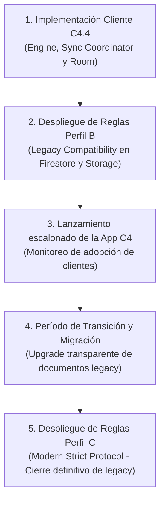

# INFORME TÉCNICO DE VALIDACIÓN DE REGLAS DE SEGURIDAD (FASE C4.3)
**Protocolo C4: Validación con Emuladores Oficiales de Firebase**
**Fecha:** 27 de Octubre de 2026
**Rama:** `feat/sync-protocol-c4-3-firebase-rules`
**Base Master:** `38e785bbbe2047c12efe7478317cd0d0e225842a`
**Proyecto Emulador:** `demo-contador-c43` (Puertos: Firestore 8888, Storage 9199)

---

## 1. RESUMEN EJECUTIVO

En la Fase C4.3 se ha construido y verificado de manera hermética una suite automatizada de pruebas de seguridad para **Cloud Firestore** y **Firebase Storage**, empleando la suite oficial de emuladores de Firebase (`firebase-tools 15.20.0`), `@firebase/rules-unit-testing 5.0.2` y el SDK modular de Firebase v12 sobre Node.js v25.

Se han formulado, contrastado y auditado tres perfiles de reglas independientes:
1. **Perfil A (Baseline):** Copia exacta de las reglas vigentes en producción (`firestore.rules` y `storage.rules`). Se documentan y verifican formalmente las vulnerabilidades críticas del esquema legacy.
2. **Perfil B (Legacy Compatibility):** Reglas de transición que permiten la convivencia pacífica de clientes legacy (sin metadatos de sincronización) con clientes modernos C4, protegiendo a los documentos modernos de degradación, regresiones y borrado físico.
3. **Perfil C (Modern Strict Protocol):** Reglas finales que imponen incremento monotónico estricto (+1), integridad de metadatos causales (`revision`, `lastMutationId`, `fieldRevisions`), inmutabilidad del propietario, inmutabilidad de fotografías versionadas, protección contra resurrección de tombstones y prohibición absoluta de borrado físico.

La suite automatizada consta de **55 casos de prueba** ejecutados directamente sobre los emuladores locales oficiales, arrojando **100% de éxito (55 passing)** sin conexión a servicios de producción ni despliegues prematuros.

---

## 2. MATRIZ DE COMPORTAMIENTO: ESPERADO VS. OBSERVADO (PASS / REJECT)

A continuación se detalla la matriz comparativa de evaluación para cada operación clave frente a los tres perfiles de reglas:

| Operación / Escenario | Perfil A (Baseline) | Perfil B (Legacy-Compat) | Perfil C (Modern-Strict) | Estado Verificado |
| :--- | :---: | :---: | :---: | :---: |
| **Lectura propia por usuario autenticado** | PASS | PASS | PASS | VERIFICADO |
| **Lectura/Escritura anónima (sin auth)** | REJECT | REJECT | REJECT | VERIFICADO |
| **Acceso cruzado (Bob accede a birras de Alice)** | REJECT | REJECT | REJECT | VERIFICADO |
| **Mutación que altera `userId` (robo de propiedad)** | REJECT | REJECT | REJECT | VERIFICADO |
| **Creación legacy (sin metadatos C4)** | PASS | PASS | REJECT | VERIFICADO |
| **Creación C4 válida (`revision: 1`, `isDeleted: false`)** | PASS | PASS | PASS | VERIFICADO |
| **Creación con `revision != 1` (ej. 0 o 5)** | PASS *(Vulnerabilidad)* | REJECT | REJECT | VERIFICADO |
| **Creación con `isDeleted: true` inicial** | PASS *(Vulnerabilidad)* | REJECT | REJECT | VERIFICADO |
| **Creación sin `lastMutationId` o vacío** | PASS *(Vulnerabilidad)* | REJECT | REJECT | VERIFICADO |
| **Creación sin `fieldRevisions` válido** | PASS *(Vulnerabilidad)* | REJECT | REJECT | VERIFICADO |
| **Avance monotónico exacto (`revision N -> N+1`)** | PASS | PASS | PASS | VERIFICADO |
| **Salto arbitrario de revisión (ej. `rev 1 -> 999`)** | PASS *(Vulnerabilidad)* | REJECT | REJECT | VERIFICADO |
| **Regresión de revisión (ej. `rev 5 -> 2`)** | PASS *(Vulnerabilidad)* | REJECT | REJECT | VERIFICADO |
| **Estancamiento de revisión (ej. `rev 2 -> 2`)** | PASS *(Vulnerabilidad)* | REJECT | REJECT | VERIFICADO |
| **Sobreescritura legacy (`.set()`) sobre doc C4** | PASS *(Vulnerabilidad)* | REJECT | REJECT | VERIFICADO |
| **Transición a Tombstone (`isDeleted: true`, `rev +1`)** | PASS | PASS | PASS | VERIFICADO |
| **Intento de resurrección (`isDeleted: true -> false`)** | PASS *(Vulnerabilidad)* | REJECT | REJECT | VERIFICADO |
| **Actualización de metadatos sobre Tombstone preservando delete** | PASS | PASS | PASS | VERIFICADO |
| **Borrado físico (`deleteDoc`) de doc activo legacy** | PASS | PASS | REJECT | VERIFICADO |
| **Borrado físico (`deleteDoc`) de doc activo C4** | PASS *(Vulnerabilidad)* | REJECT | REJECT | VERIFICADO |
| **Borrado físico (`deleteDoc`) de Tombstone C4** | PASS *(Vulnerabilidad)* | REJECT | REJECT | VERIFICADO |
| **Actualización (upgrade) de doc legacy a C4 `rev: 1`** | N/A | PASS | REJECT *(Exige C4 nativo)* | VERIFICADO |
| **Subida de foto válida (<5MB, MIME `image/*`)** | PASS | PASS | PASS | VERIFICADO |
| **Subida de foto ajena o sin autenticación** | REJECT | REJECT | REJECT | VERIFICADO |
| **Subida de archivo > 5MB** | REJECT | REJECT | REJECT | VERIFICADO |
| **Subida de tipo no imagen (ej. `text/plain`, `.sh`)** | REJECT | REJECT | REJECT | VERIFICADO |
| **Subida de foto no versionada (legacy)** | PASS | PASS | REJECT | VERIFICADO |
| **Sobreescritura de foto legacy no versionada** | PASS | PASS | REJECT | VERIFICADO |
| **Borrado físico de foto legacy no versionada** | PASS | PASS | REJECT | VERIFICADO |
| **Sobreescritura de foto versionada (`syncId_mutId.jpg`)** | PASS *(Vulnerabilidad)* | REJECT *(Inmutable)* | REJECT *(Inmutable)* | VERIFICADO |
| **Borrado de foto versionada (`syncId_mutId.jpg`)** | PASS *(Vulnerabilidad)* | REJECT *(Inmutable)* | REJECT *(Inmutable)* | VERIFICADO |
| **Lectura de foto por amigo aceptado (`isFriend`)** | PASS | PASS | PASS | VERIFICADO |
| **Lectura de foto por amigo pendiente o extraño** | REJECT | REJECT | REJECT | VERIFICADO |

---

## 3. AUDITORÍA DEL PERFIL A (BASELINE) Y VULNERABILIDADES CONFIRMADAS

El Perfil A reproduce fielmente las reglas vigentes en `azca99/contador-de-birras`. Las pruebas automatizadas en `baseline.test.js` evidencian los siguientes riesgos estructurales:

1. **Ausencia de control monotónico en Firestore:**
   La regla `allow update: if isBeerOwner() && request.resource.data.userId == resource.data.userId;` permite a un cliente malicioso o desincronizado saltar revisiones a conveniencia (ej. de 1 a 999) o retroceder revisiones (ej. de 5 a 2), lo que invalida cualquier garantía de consistencia causal o convergencia determinista.
2. **Destrucción de historial mediante borrado físico:**
   `allow delete: if isBeerOwner();` permite la invocación directa de `deleteDoc` sobre documentos activos y, críticamente, sobre **tombstones**. Si un cliente elimina físicamente un tombstone, otros dispositivos en la topología nunca sabrán que el documento fue borrado y sufrirán "resurrecciones fantasma".
3. **Resurrección no controlada:**
   No existe discriminación entre estados activos y borrados (`isDeleted`). Un cliente puede cambiar `isDeleted: true` a `false` arbitrariamente sin pasar por una reconciliación de conflictos.
4. **Degradación silenciosa por escrituras ciegas (`.set()`):**
   Un cliente que use `.set()` sin mezclar campos (`merge: true`) puede purgar `revision`, `lastMutationId` y `fieldRevisions`, devolviendo un documento avanzado a un estado no gestionado.
5. **Mutabilidad destructiva en Firebase Storage:**
   La regla `allow update, delete: if request.auth != null && request.auth.uid == userId;` permite sobreescribir o borrar cualquier archivo bajo `/users/{userId}/beers/`. Esto destruye las fotografías inmutables versionadas asociadas a revisiones causales específicas.

---

## 4. PERFIL B (LEGACY COMPATIBILITY) VS. PERFIL C (MODERN STRICT PROTOCOL)

### 4.1 Perfil B: Coexistencia y Transición Segura
El Perfil B está diseñado para desplegarse durante la fase de migración:
- **Detección por discriminador de presencia (`'revision' in resource.data`):**
  - Si un documento no posee el campo `revision`, se considera documento **legacy**. Permite actualizaciones y borrados físicos según las reglas tradicionales para no romper clientes antiguos en producción.
  - Si un documento posee `revision`, se activa automáticamente la protección moderna: exige incremento monotónico `+1`, metadatos válidos, prohíbe el borrado físico (`delete: if false`) y previene la resurrección.
- **Ruta de modernización controlada (Upgrade Path):**
  Un documento legacy puede transicionar a moderno únicamente mediante una escritura que introduzca `revision: 1`, `isDeleted: false`, `lastMutationId` válido y `fieldRevisions`. Una vez modernizado, queda sellado contra degradaciones o borrados.
- **Protección anti-downgrade:**
  Se prohíbe explícitamente a un cliente legacy sobreescribir un documento que ya haya sido modernizado.

### 4.2 Perfil C: Protocolo Estricto C4
El Perfil C es el estado final post-migración:
- Todo documento en la colección `/beers/` debe regirse por el esquema C4.
- Las creaciones deben originarse estrictamente en `revision: 1` con `isDeleted: false`.
- Las actualizaciones exigen estrictamente `request.resource.data.revision == resource.data.revision + 1`.
- Prohibición total de borrado físico (`allow delete: if false;`).
- Toda fotografía debe cumplir la nomenclatura versionada `syncId_mutationId.ext`.

---

## 5. LÍMITES DEL MOTOR DE REGLAS DE FIREBASE Y RIESGOS RESIDUALES

Durante la validación en el emulador se han verificado los límites intrínsecos de Firebase Security Rules:

1. **Ausencia de estado histórico / Evaluación stateless:**
   Firebase Rules solo compara el estado previo inmediato (`resource.data`) con el estado propuesto (`request.resource.data`). No tiene acceso a un log de eventos ni a revisiones intermedias. Por tanto, no puede reconstruir cadenas causales pasadas ni determinar si un salto de versión omitió mutaciones intermedias legítimas. Esto exige que el cliente local (Android Room + C4.4) mantenga la persistencia durable de mutaciones pendientes.
2. **Imposibilidad de iteración dinámica no acotada:**
   El lenguaje de reglas de Firestore carece de bucles `for` o `while`. No es posible verificar si cada clave dinámica dentro de `fieldRevisions` corresponde exactamente a un campo modificado sin declarar de antemano el conjunto exhaustivo de campos. Por ello, las reglas validan la integridad estructural (`fieldRevisions is map && fieldRevisions.size() <= 50`), delegando la resolución de conflictos a nivel de campo al coordinador local (validado en C4.2).
3. **Inmutabilidad en Storage mediante `resource == null`:**
   En Firebase Storage, una operación de subida (PUT) sobre un objeto existente es evaluada bajo `create` a menos que se restrinja explícitamente `resource == null`. Para garantizar inmutabilidad absoluta, las reglas versionadas deben exigir:
   ```javascript
   allow create: if resource == null && isOwner() && isVersionedFormat() && isValidImage();
   allow update, delete: if false;
   ```
   Sin la comprobación `resource == null`, el motor de reglas permitiría sobreescrituras bajo la cláusula `create`.

---

## 6. POLÍTICA DE TOMBSTONES E INMUTABILIDAD FOTOGRÁFICA

### 6.1 Política de Tombstones
- El borrado físico de documentos Firestore queda abolido para el protocolo C4 (`allow delete: if false;`).
- Toda eliminación es una mutación causal: el cliente envía una actualización con `isDeleted: true`, avanzando la revisión `+1` y registrando el `lastMutationId`.
- **Regla Anti-Resurrección Formal:**
  ```javascript
  (resource.data.isDeleted == true ? request.resource.data.isDeleted == true : true)
  ```
  Una vez que `isDeleted == true` se consolida en Firestore, ninguna actualización puede regresar `isDeleted` a `false`. La única forma de "volver a crear" la cerveza es generar una nueva entidad con un `syncId` diferente.

### 6.2 Política de Fotografías en Storage
- Los ficheros fotográficos se versionan bajo el esquema inmutable:
  `/users/{userId}/beers/{syncId}_{mutationId}.jpg`
- Las reglas de Storage imponen que cualquier fichero versionado no puede modificarse ni borrarse una vez subido (`allow update, delete: if false;` con `resource == null` en create).
- Si el usuario edita la foto de una cerveza, se genera una nueva mutación con un nuevo `mutationId`, subiendo una nueva foto con nombre distinto. La referencia en Firestore apuntará al nuevo nombre.
- Las fotos huérfanas de tombstones o mutaciones desplazadas podrán ser depuradas en el futuro mediante procesos batch controlados en Cloud Functions/Backend, nunca por clientes móviles de forma síncrona.

---

## 7. ORDEN SEGURO DE DESPLIEGUE EN FASES FUTURAS

Para evitar denegaciones de servicio (PERMISSION_DENIED) a los usuarios que utilicen versiones previas de la app, el despliegue a producción DEBE seguir rigurosamente el siguiente orden:



> [!CAUTION]
> **Prohibición de despliegue prematuro de Perfil C:** Desplegar el Perfil C antes de que el 100% de los clientes activos ejecuten la versión C4 bloquearía inmediatamente a los clientes antiguos, ya que sus escrituras carecen de `revision == 1` y metadatos de sincronización.

---

## 8. TESTS PENDIENTES PARA LA FASE C4.4 (COORDINADOR REAL)

La presente Fase C4.3 ha validado la barrera de seguridad perimetral (Reglas de Firebase). La siguiente Fase C4.4 deberá validar la integración entre el `BeerSyncEngine` y los emuladores oficiales:

1. **Pruebas de Push Real:**
   Envío de lotes de mutaciones desde Room hacia el emulador de Firestore, verificando la recepción de timestamps del servidor y confirmación atómica en SQLite.
2. **Pruebas de Pull Real:**
   Recepción de snapshots y cambios incrementales desde el emulador de Firestore, clasificando en `AuthoritativeConfirmed`, `ConflictDetected` o `ForeignWins`.
3. **Subida y Reintento Fotográfico en Storage:**
   Pruebas de subida de imágenes reales contra el emulador de Storage (puerto 9199), almacenamiento de `photoUri` versionado y tolerancia a fallos transitorios de red.
4. **Recuperación tras PERMISSION_DENIED:**
   Verificación de que el coordinador de la app captura limpiamente un fallo de precondición (ej. conflicto por escritura concurrente de otro dispositivo) y ejecuta el flujo de PULL y re-planificación de mutaciones sin bucles infinitos ni caídas (ANR/Crash).

---

## 9. REGISTRO DE ARTEFACTOS GENERADOS

- **Fixtures de Reglas:**
  - [`firestore.baseline.rules`](file:///c:/Users/Daniel/.gemini/antigravity/scratch/beer-hunter/tests/firebase-rules/fixtures/firestore.baseline.rules)
  - [`storage.baseline.rules`](file:///c:/Users/Daniel/.gemini/antigravity/scratch/beer-hunter/tests/firebase-rules/fixtures/storage.baseline.rules)
  - [`firestore.legacy-compat.rules`](file:///c:/Users/Daniel/.gemini/antigravity/scratch/beer-hunter/tests/firebase-rules/fixtures/firestore.legacy-compat.rules)
  - [`storage.legacy-compat.rules`](file:///c:/Users/Daniel/.gemini/antigravity/scratch/beer-hunter/tests/firebase-rules/fixtures/storage.legacy-compat.rules)
  - [`firestore.modern-strict.rules`](file:///c:/Users/Daniel/.gemini/antigravity/scratch/beer-hunter/tests/firebase-rules/fixtures/firestore.modern-strict.rules)
  - [`storage.modern-strict.rules`](file:///c:/Users/Daniel/.gemini/antigravity/scratch/beer-hunter/tests/firebase-rules/fixtures/storage.modern-strict.rules)
- **Suite de Pruebas Node.js:**
  - [`test/helpers.js`](file:///c:/Users/Daniel/.gemini/antigravity/scratch/beer-hunter/tests/firebase-rules/test/helpers.js)
  - [`test/baseline.test.js`](file:///c:/Users/Daniel/.gemini/antigravity/scratch/beer-hunter/tests/firebase-rules/test/baseline.test.js) (6 tests)
  - [`test/firestore-modern.test.js`](file:///c:/Users/Daniel/.gemini/antigravity/scratch/beer-hunter/tests/firebase-rules/test/firestore-modern.test.js) (17 tests)
  - [`test/firestore-legacy-compat.test.js`](file:///c:/Users/Daniel/.gemini/antigravity/scratch/beer-hunter/tests/firebase-rules/test/firestore-legacy-compat.test.js) (10 tests)
  - [`test/storage-security.test.js`](file:///c:/Users/Daniel/.gemini/antigravity/scratch/beer-hunter/tests/firebase-rules/test/storage-security.test.js) (16 tests)
  - [`test/concurrency-retries.test.js`](file:///c:/Users/Daniel/.gemini/antigravity/scratch/beer-hunter/tests/firebase-rules/test/concurrency-retries.test.js) (6 tests)
- **Configuración de Dependencias:**
  - [`package.json`](file:///c:/Users/Daniel/.gemini/antigravity/scratch/beer-hunter/tests/firebase-rules/package.json)
  - [`package-lock.json`](file:///c:/Users/Daniel/.gemini/antigravity/scratch/beer-hunter/tests/firebase-rules/package-lock.json)
